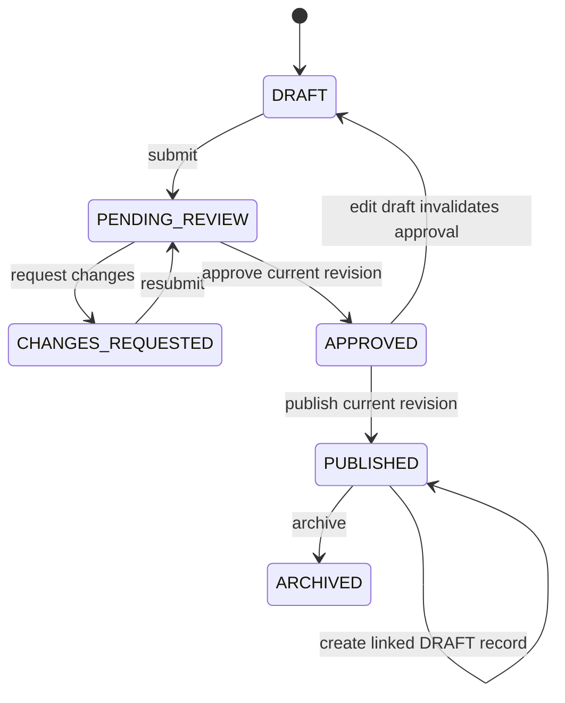
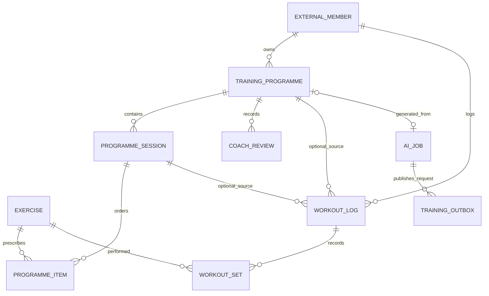

# Smart Gym

Smart Gym is a gym-management platform. This repository includes the M1
membership service and M3 training service: Keycloak-backed Angular sign-in,
membership management, subscriptions, payments, coach assignments, training
programmes and workouts, RabbitMQ events, and AI-assisted workflows.

## Development ownership

| Area                                  | Owner                                      |
| ------------------------------------- | ------------------------------------------ |
| M1 membership-service                 | Nour                                       |
| M2 courses-service                    | Yacine                                     |
| M3 training-service                   | Pending confirmation: Moez or Mehdi        |
| M4 nutrition-service                  | Pending confirmation: the remaining member |
| M5 Keycloak and shared infrastructure | Shared team responsibility                 |

These are project ownership assignments, not application roles. Application
roles are `ADMIN`, `COACH`, and `MEMBER`; users may have overlapping roles.
The development accounts provisioned by the script below are local test
identities and are not mapped to any developer.

## Development-only URLs and startup

The local HTTP configuration is for development only:

| Component                 | URL                                                |
| ------------------------- | -------------------------------------------------- |
| Angular/Nginx             | `http://localhost:8088`                            |
| Keycloak                  | `http://localhost:8180`                            |
| Realm                     | `gym`                                              |
| Business API              | `http://localhost:8088/api/...` (proxied by Nginx) |
| OpenAPI JSON              | `http://localhost:8081/v3/api-docs`                |
| RabbitMQ management       | `http://localhost:15672`                           |
| Groq chat completions API | `https://api.groq.com/openai/v1/chat/completions`  |

Compose services are `postgres`, `keycloak-db`, `keycloak`, `rabbitmq`,
`api`, `training-db-init`, `training-service`, and `frontend`. The optional
`ollama` service is available with the `local-llm` Compose profile. The Spring API and PostgreSQL are also
exposed on host ports `8081` and `5433` for local development and
provisioning. RabbitMQ exposes AMQP on port `5672` and its management
interface on `15672`. `keycloak-db` is internal to the Compose network and
has no host port. Browser API calls should use the Nginx `/api/...` URLs.

1. Copy `.env.example` to `.env` and set unique local-only passwords,
   provisioning key, and the four `DEV_*_PASSWORD` values for test accounts.
   Do not use these development secrets outside your local machine.
2. Start the core platform:

   ```powershell
   Copy-Item .env.example .env
   ```

3. Replace the placeholder values in `.env` with unique local-only
   credentials. The following are the variables in `.env.example`:

   | Variable | Role | Required by Compose |
   | --- | --- | --- |
   | `KEYCLOAK_BASE_URL` | Optional Keycloak URL override for development environments | No |
   | `KEYCLOAK_ADMIN_USERNAME` | Keycloak local administrator username | Yes |
   | `KEYCLOAK_ADMIN_PASSWORD` | Keycloak local administrator password | Yes |
   | `KEYCLOAK_PROVISIONER_SECRET` | Secret for the API's limited Keycloak account-provisioning client | Yes |
   | `POSTGRES_PASSWORD` | Password for the local PostgreSQL databases | Yes |
   | `PROVISIONING_TOKEN` | Token for the development-only profile provisioning API | Yes |
   | `DEV_ADMIN_PASSWORD` | Local-only password for `gym-admin` | Provisioning script |
   | `DEV_COACH_PASSWORD` | Local-only password for `gym-coach` | Provisioning script |
   | `DEV_MEMBER_A_PASSWORD` | Local-only password for `member-a` | Provisioning script / E2E fallback |
   | `DEV_MEMBER_B_PASSWORD` | Local-only password for `member-b` | Provisioning script |
   | `SEED_ACCOUNT_PASSWORD` | Shared password for additional `demo-*` accounts | Project demo seed |
   | `RABBITMQ_USER` | RabbitMQ username | Yes |
   | `RABBITMQ_PASSWORD` | RabbitMQ password | Yes |
   | `TRAINING_DB_USER` | Training database username | No |
   | `TRAINING_DB_PASSWORD` | Training database password | No |
   | `OLLAMA_MODEL` | Optional local training AI model | No |
   | `APP_AI_OLLAMA_TIMEOUT` | Ollama programme-generation request timeout | No |
   | `APP_AI_INSIGHTS_TIMEOUT` | Ollama workout-insights request timeout | No |
   | `GROQ_API_KEY` | Optional Groq key for feedback analysis | No |
   | `GROQ_MODEL` | Groq model used for feedback analysis | No |
   | `APP_LLM_CONNECT_TIMEOUT` | Feedback-analysis provider connection timeout | No |
   | `APP_LLM_READ_TIMEOUT` | Feedback-analysis provider response timeout | No |
   | `LLM_BASE_URL` | OpenAI-compatible API base URL; defaults to Groq | No |
   | `LLM_MODEL` | Groq model ID; defaults to `openai/gpt-oss-20b` | No |
   | `LLM_API_KEY` | Groq API key; replace the placeholder with a locally stored key | Yes |
   | `LLM_TIMEOUT_SECONDS` | LLM request timeout in seconds; defaults to `30` | No |

If the administrative assistant reports a provider error, its response
identifies whether the configured key was rejected or the model/API endpoint
was not found. Replace revoked or exposed keys in the ignored `.env`, confirm
`LLM_MODEL` and `LLM_BASE_URL` match the selected provider, and recreate the
API container. Never put provider response bodies or API keys in tracked files
or logs.

Generate a local provisioning token with:

```powershell
.\scripts\provision-dev.ps1
```

The script reads `KEYCLOAK_ADMIN_*`, `PROVISIONING_TOKEN`, and the four
`DEV_*_PASSWORD` values from the repository `.env` file. Shell variables
override `.env` when both are set.

To add a larger, synthetic dataset for local exploration, set a unique
`SEED_ACCOUNT_PASSWORD` in the ignored `.env` file, start the development
Compose stack, provision the four base accounts with
`.\scripts\provision-dev.ps1`, then run:

```powershell
.\scripts\seed-project-demo.ps1
```

This development-only script ensures 20 accounts (1 admin, 2 coaches, and 17
members) and creates 190 synthetic database rows across subscriptions/payments,
feedback/themes, nutrition food/journal/hydration, and training exercises,
workout history, and sets.
New accounts are `demo-coach-01` and `demo-member-01` through
`demo-member-15`; they share the password from `SEED_ACCOUNT_PASSWORD`.
Existing `gym-admin`, `gym-coach`, `member-a`, and `member-b` passwords are
not changed. All seeded rows use stable identifiers and are updated on
reruns; existing unrelated records are not deleted. This script writes
directly to the local Compose PostgreSQL databases and requires the
development-only `/api/dev/provision` endpoint. Never use it against a
production or shared environment.

Account usernames are `gym-admin`, `gym-coach`, `member-a`, and
`member-b`. The script creates or updates these Keycloak users, applies
their application roles, and idempotently provisions their business
profiles and coach assignments through the Keycloak Admin API and
development provisioning endpoint. It prints the usernames, never their
passwords. Passwords are supplied only through environment variables and
are not stored in source control. The Keycloak administrator account is
infrastructure-only; it is not an application administrator. 4. Open `http://localhost:8088` and select **Sign in**.

## Database schema and migrations

The API uses Flyway migrations under
`backend/src/main/resources/db/migration`. `V1__baseline.sql` creates the
initial PostgreSQL schema; V2–V6 add calorie-target mode, generation-context
snapshots, persistent dated plans, saved goals/preferences/hydration, and
feedback persistence.
New installations using a fresh, empty database apply the complete migration
sequence on first API startup; Hibernate validates the mapped schema and does
not modify it. If the Compose PostgreSQL volume already contains a database,
review the existing database procedure below before starting the API.

For an existing database, first take a database backup and compare its schema
with `V1__baseline.sql`. Do not baseline a database with unrelated or
unreviewed schema drift. First inspect whether `flyway_schema_history` already
exists; do not baseline a database that already has migration history. Only
after confirming the existing schema represents V1 and there is no migration
history, stop the API and start it once with Flyway's baseline options:

```powershell
docker compose up --build -d
docker compose ps
```

3. Wait for Keycloak and the API to become healthy, then provision the four
   development accounts and their business profiles:

   ```powershell
   docker compose logs api --tail 50
   ```

### Provision development accounts

Keycloak credential validation and invalid-credential messages stay on the
Keycloak-hosted login page. The realm uses a small Smart Gym CSS theme.
MailHog is configured as the local SMTP sink for assistant reminders;
password-recovery email is intentionally disabled and is not operational.

The Compose stack routes `/api/membership`, `/api/courses`, and
`/api/nutrition` to the secured membership API while preserving the full
prefix. Nutrition endpoints provide member-scoped foods, meal plans, food
journal entries, body measurements, profiles, nutritional calculations,
persistent meal plans, hydration, and an optional Groq meal-plan assistant.
The `/api/training` prefix is routed to the separate training-service; the
remaining routes use the membership API.

## Nutrition & Body Tracking (Module 4)

### Starting and using Nutrition

Prerequisites are Docker Desktop with Docker Compose v2 and access to the
container image registries used by the Compose file. No host-installed Java,
Maven, Node.js, or npm is required for the container-based commands below.

1. Copy `.env.example` to `.env`. Replace the placeholder values for
   `KEYCLOAK_ADMIN_PASSWORD`, `POSTGRES_PASSWORD`, and `PROVISIONING_TOKEN`
   with unique development-only secrets. Keep `.env` private and never commit
   it. `KEYCLOAK_ADMIN_USERNAME` defaults to `admin`.
2. Start the services:

   ```powershell
   docker compose up --build -d
   docker compose ps
   ```

   Compose starts `postgres`, `keycloak-db`, `keycloak`, `api`, and
   `frontend`; database health checks gate dependent services. `api` and
   `frontend` are built from the repository Dockerfiles.

3. Provision development accounts if this is a new local environment (set the
   `DEV_*_PASSWORD` entries in `.env`, then run):

   ```powershell
   .\scripts\provision-dev.ps1
   ```

   The script provisions `gym-admin`, `gym-coach`, `member-a`, and `member-b`
   using secrets from `.env`. Keep `.env` private and never commit it.

4. Open `http://localhost:8088`, sign in with an account assigned the
   `MEMBER` or `ADMIN` role, and select **Nutrition** from the dashboard.
   Use the Nutrition workspace's Overview, My Plan, My Progress, Food Library,
   and Food Journal views. New members can complete the six-step profile setup;
   saved profile and goal values use the authenticated nutrition profile API.
   Choose automatic daily calories to estimate an adult target from age,
   height, current weight, activity, goal, and the optional Mifflin–St Jeor
   equation input; or choose a manual target. Automatic estimates recalculate
   when the profile is saved and are not medical advice. The Nutrition page
   includes daily totals, profile-based BMI and saved-target macro estimates,
   food and meal-plan CRUD, journal CRUD, and measurement history. Local
   illustrated meal cards are used because this repository has no food-photo
   assets; the UI does not fetch unstable remote images.
   Members generate profile-based recipe suggestions on their own Nutrition
   page, review ingredients, quantities, preparation instructions and
   estimated nutrition, then save daily or seven-day plans to their account.
   Saved plans have dated days and persisted meals; members can regenerate one
   day or replace one meal. Coaches can open **Coach Nutrition** to review and
   edit only assigned members' saved plans and foods. Coaches do not generate
   or approve member plans. Assignment, ownership and saved generation
   restrictions are checked server-side. Profile targets, goal estimates,
   separate allergy/intolerance/dislike/ingredient preferences, cooking
   preferences and drinking-water logs are persisted through authenticated
   APIs. Shopping lists and alternatives remain review-only and are not
   persisted. The AI assistant is optional; see its configuration below.

The `.env` values directly required by Compose are the Keycloak bootstrap
username/password, PostgreSQL password, and provisioning token. Compose sets
the API datasource URL/username and Keycloak issuer/JWKS URLs in the API
service configuration. Groq is optional: set `GROQ_API_KEY` in the private
`.env` file and choose `GROQ_MODEL`. The README example uses
`openai/gpt-oss-20b`, which Groq's Structured Outputs documentation currently
uses as a supported-model example. Model availability can change and can
depend on account access; check the current [Groq model catalog](https://console.groq.com/docs/models)
and your account's available models before relying on it. The Groq catalog
also documents the authenticated Models API for listing active IDs; this
application does not call it. Do not put a real
API key in source control, build arguments, Angular code, or logs.
`APP_LLM_CONNECT_TIMEOUT` and `APP_LLM_READ_TIMEOUT` control backend HTTP
timeouts and default to `5s` and `120s`.

### Groq meal-plan integration

The backend sends requests only to Groq's official
`https://api.groq.com/openai/v1/chat/completions` endpoint. Compose passes
`GROQ_API_KEY` and `GROQ_MODEL` to the API container; neither is provided to
the frontend. The API key is sent in the backend-only `Authorization: Bearer`
header and is not included in the request body or logged by the adapter.

The request uses the configured model, `system` and `user` chat messages, and
`response_format` with `type: json_schema`, `strict: true`, and a meal-plan
schema, with an explicit completion budget. It requests exactly three concise
meals per generated day and omits shopping-list and alternative suggestions
from the model response to reduce avoidable output. Those suggestions remain
unavailable for AI-generated drafts; saved-plan behavior is unchanged. See
Groq's [Structured Outputs documentation](https://console.groq.com/docs/structured-outputs).
If Groq specifically rejects the strict schema format with HTTP 400/422, the
backend retries once using JSON-object mode. It then applies the same DTO,
numeric, meal-type, serving, size, and restriction checks before returning
anything; this fallback does not bypass application validation. A provider
error explicitly identifying completion-token exhaustion is not retried, and
is reported separately from a strict-schema compatibility rejection.
Groq's response is read from `choices[0].message.content`, which must contain
the plan JSON. The application then performs its own DTO, numeric, meal-type,
serving, size, and restriction checks. Strict JSON mode does not replace
application validation.

Meal-plan prompts generate complete recipes whether or not their ingredients
exist in the saved food library, with ingredient quantities and preparation
instructions. Saved foods are optional matches and must not distort the recipe.
The model also estimates a complete meal serving's weight, calories, protein,
carbohydrates, fat, fiber, and sodium for coach review.
Prompts favor lean protein, vegetables, legumes, whole grains, and lighter
cooking methods while limiting deep-frying, processed meats, pastries, and
excess salt. These are generation preferences, not a medical or nutritional
guarantee; review meals and estimates before saving.

Saved goal, calorie target, dietary style, supported food preferences,
explicit request restrictions, and optional member-owned food names/nutrition
are sent as generation context. JWTs, member subjects, profile age, height,
and weight are not sent. Do not add sensitive personal data to the prompt.

If `GROQ_API_KEY` is empty, generation returns `UNAVAILABLE` without a
network call. The model default is `openai/gpt-oss-20b`; override it with a
model currently available to your account using `GROQ_MODEL`. Authentication
errors, rate limits, timeouts, network failures, and malformed responses
produce non-secret unavailable messages. HTTP 400/422 responses point to model
availability and strict JSON Schema support; 404 identifies an unavailable
model, 413 identifies an oversized request, and 5xx responses are reported as
temporary provider failures. For 429 rate limits, the API includes a bounded
`Retry-After` hint when Groq supplies one and otherwise advises checking
account usage/model limits. Provider response bodies are not returned to the
member. The call continues to run on the existing bounded asynchronous executor. No live Groq request has been made
as part of this implementation; generation against an active account/model
remains unverified.

Groq-hosted model output is untrusted. Explicit and saved restrictions,
including the default pork and pork-derived ingredient exclusion, are checked
before a suggestion is returned and again when a member saves a plan or a
member/assigned coach edits a saved meal. Each saved plan retains its
generation context; later profile changes do not rewrite that context. These
checks do not establish allergy safety or medical suitability. Nutrition
remains an estimate and requires member review before saving.
Inference runs outside servlet request threads on a bounded pool (up to four
active calls and eight queued requests). The existing plan-generation route
keeps its response shape; saturated requests return an explicit unavailable
response instead of adding unbounded work.
Review every meal before saving. Daily and weekly plans use a persisted plan,
dated-day, meal and meal-item relationship. The older individual meal-plan
records remain available for compatibility. Shopping lists and alternatives
are shown for review but are not persisted.

### Nutrition API

All routes below are under `/api/nutrition`. They require a valid Keycloak JWT
and the `ADMIN` or `MEMBER` application role. The server derives the data
owner from the JWT subject; there is no client-supplied owner ID. Lists and
record operations are scoped to that subject, including for admins.
Validation failures generally return `400`; missing or non-owned records
return `404`. Food deletion returns `409` while any journal entry or meal-plan
item references that food.

| Method and path                                        | Behavior and principal validation                                                                                                                                                                                                                                                                                                                                                                               |
| ------------------------------------------------------ | --------------------------------------------------------------------------------------------------------------------------------------------------------------------------------------------------------------------------------------------------------------------------------------------------------------------------------------------------------------------------------------------------------------- |
| `POST /foods`                                          | Create a food. Requires a nonblank name, positive serving size in grams, and finite nonnegative calories, protein, carbohydrates, fat, fiber, and sodium. Name/brand max 150 characters.                                                                                                                                                                                                                        |
| `GET /foods`                                           | List the authenticated subject's foods.                                                                                                                                                                                                                                                                                                                                                                         |
| `PUT /foods/{foodId}`                                  | Replace a food's editable values, with the create validation rules; only its owner can update it.                                                                                                                                                                                                                                                                                                               |
| `DELETE /foods/{foodId}`                               | Delete an owned food only when it is not referenced by a journal entry or meal plan.                                                                                                                                                                                                                                                                                                                            |
| `POST /meal-plans`                                     | Create one meal record. Requires a name, supported meal type, nonnegative target calories, and at least one food with positive servings. Every food must belong to the caller.                                                                                                                                                                                                                                  |
| `GET /meal-plans`                                      | List the authenticated subject's meal plans.                                                                                                                                                                                                                                                                                                                                                                    |
| `PUT /meal-plans/{mealPlanId}`                         | Update an owned meal plan, with create validation and food-ownership checks.                                                                                                                                                                                                                                                                                                                                    |
| `DELETE /meal-plans/{mealPlanId}`                      | Delete an owned meal plan.                                                                                                                                                                                                                                                                                                                                                                                      |
| `POST /food-journal`                                   | Create a journal entry with an owned food, meal type, ISO date, and positive servings. Notes max 300 characters.                                                                                                                                                                                                                                                                                                |
| `GET /food-journal`                                    | List the authenticated subject's journal entries.                                                                                                                                                                                                                                                                                                                                                               |
| `PUT /food-journal/{entryId}`                          | Update an owned entry, with create validation and food-ownership checks.                                                                                                                                                                                                                                                                                                                                        |
| `DELETE /food-journal/{entryId}`                       | Delete an owned journal entry.                                                                                                                                                                                                                                                                                                                                                                                  |
| `POST /body-measurements`                              | Create a dated measurement. Weight (kg), waist, hip, chest, arm, and thigh (cm) are required and positive; notes max 300 characters.                                                                                                                                                                                                                                                                            |
| `GET /body-measurements`                               | List the authenticated subject's measurement history.                                                                                                                                                                                                                                                                                                                                                           |
| `PUT /body-measurements/{measurementId}`               | Update an owned measurement, with create validation.                                                                                                                                                                                                                                                                                                                                                            |
| `DELETE /body-measurements/{measurementId}`            | Delete an explicitly selected owned measurement record.                                                                                                                                                                                                                                                                                                                                                         |
| `POST /profiles`                                       | Create or update the caller's latest profile, including goal, current/target weight, optional desired date, dietary style, allergies, intolerances, dislikes, preferred ingredients, budget and preparation preferences. Identity comes from the JWT. Targets require an adult profile, valid current measurements, a compatible supported goal, and a target not below the adult BMI 18.5 screening threshold. |
| `GET /profiles`                                        | Read the caller's latest profile; returns `404` when none exists.                                                                                                                                                                                                                                                                                                                                               |
| `GET /calculations/goal-timeline`                      | Return a deterministic approximate range for supported adult weight-loss goals only; includes the 0.25–0.5 kg/week assumptions and comparison with an optional requested date. Other goals, minors, and missing/invalid inputs return an unavailable response.                                                                                                                                                  |
| `POST /hydration`                                      | Add a drinking-water log (1–2,000 mL). The server supplies the timestamp if omitted; member identity is derived from the JWT.                                                                                                                                                                                                                                                                                   |
| `GET /hydration?date=YYYY-MM-DD`                       | Read one member-owned UTC-day total, logs and the general estimated 2,000 mL/day target. This tracks drinks, not moisture from food.                                                                                                                                                                                                                                                                            |
| `GET /hydration/history?from=YYYY-MM-DD&to=YYYY-MM-DD` | Read the caller's bounded hydration history.                                                                                                                                                                                                                                                                                                                                                                    |
| `PUT /hydration/{logId}` / `DELETE /hydration/{logId}` | Correct or remove an owned log, with amount, timestamp and daily-total validation.                                                                                                                                                                                                                                                                                                                              |
| `GET /calculations?foodIds={id}&servings={n}`          | Sum calories, macros, fiber, and sodium for the supplied owned food IDs. Repeat `foodIds` and `servings` parameters for multiple foods. Servings are optional (default one per food); when supplied, there must be exactly one positive finite quantity per ID.                                                                                                                                                 |
| `GET /calculations/bmi`                                | Calculate BMI from profile kilograms and centimetres converted to metres. Returns `422` for a known minor or missing/invalid height or weight. This is a screening measurement, not a diagnosis.                                                                                                                                                                                                                |
| `GET /calculations/macros`                             | Estimate protein (1.6 g/kg), fat (25% of the saved calorie target), and carbohydrates from remaining calories. Requires a profile (`404` if absent) with positive saved weight and target calories; returns `422` if inputs are missing or the target cannot support nonnegative carbohydrates. This uses the manually saved target, not TDEE.                                                                  |
| `GET /calculations/energy`                             | Calculate an adult Mifflin–St Jeor estimate when age, height, weight, equation selection, supported activity and goal are available; otherwise return an unavailable response with the missing requirement. This is an estimate, not medical advice.                                                                                                                                                            |
| `GET /food-journal/daily?date=YYYY-MM-DD`              | Return the caller's daily totals and meal-level calories, macros, fiber, and sodium for the required date, scaled by logged servings.                                                                                                                                                                                                                                                                           |
| `POST /assistant/plan`                                 | Request a legacy AI suggestion. The UI sends request restrictions; profile, saved preferences and food context come from the authenticated caller. An available response includes a server-issued generation-context ID. Returns `UNAVAILABLE` when not configured, unreachable, malformed, or rejected; executor saturation/failure is surfaced.                                                               |
| `POST /assistant/plan/save`                            | Save a reviewed legacy suggestion. The server resolves the one-time generation context for the authenticated member and rechecks its restrictions rather than trusting save-request restrictions.                                                                                                                                                                                                               |
| `POST /assistant/plans/draft`                          | Generate a daily or seven-day suggestion for the authenticated member, returning structured dated days and meals with quantities, instructions and supported nutrition estimates.                                                                                                                                                                                                                               |
| `POST /plans`                                          | Save the member-reviewed draft as a persistent daily or weekly plan with its immutable generation context.                                                                                                                                                                                                                                                                                                      |
| `GET /plans` / `GET /plans/{planId}`                   | List or retrieve the caller's saved plans and dated meals.                                                                                                                                                                                                                                                                                                                                                      |
| `POST /plans/{planId}/days/{date}/regenerate`          | Regenerate only an owned plan day using its original context and expected plan version.                                                                                                                                                                                                                                                                                                                         |
| `POST /plans/{planId}/meals/{mealId}/replace`          | Replace one meal while preserving other plan content, using the plan's saved context and version.                                                                                                                                                                                                                                                                                                               |

### Coach meal-plan review

Coach nutrition routes are under `/api/nutrition/coach` and require the
`COACH` application role. Each operation resolves the member profile ID to its
authenticated member subject and checks the coach assignment server-side:

| Method and path                                                            | Behavior                                                                                                                                   |
| -------------------------------------------------------------------------- | ------------------------------------------------------------------------------------------------------------------------------------------ |
| `GET /members/{memberProfileId}/foods`                                     | List foods belonging to an assigned member.                                                                                                |
| `PUT /members/{memberProfileId}/foods/{foodId}`                            | Update an assigned member's existing food; the food must belong to that member.                                                            |
| `DELETE /members/{memberProfileId}/foods/{foodId}`                         | Delete an assigned member's food only when it is not referenced by a journal entry or meal plan.                                           |
| `GET /members/{memberProfileId}/meal-plans`                                | Review saved meal plans belonging to an assigned member.                                                                                   |
| `PUT /members/{memberProfileId}/meal-plans/{mealPlanId}`                   | Edit a plan belonging to an assigned member; every linked food must also belong to that member.                                            |
| `GET /members/{memberProfileId}/plans`                                     | List persistent plans for an assigned member.                                                                                              |
| `PUT /members/{memberProfileId}/plans/{planId}/days/{date}/meals/{mealId}` | Edit a meal in an assigned member's saved plan. The backend checks assignment, ownership, expected version and original plan restrictions. |

Plan-specific generation restrictions are durably stored with the associated
context and rechecked during save, day regeneration, meal replacement and
coach edits. Coaches see suggestions only after a member saves them; there is
no separate persisted draft/review state. Shopping lists and alternatives are
not persisted. Restriction checks do not guarantee medical or allergy safety.

All meal-type values are `BREAKFAST`, `LUNCH`, `DINNER`, `SNACK`,
`PRE_WORKOUT`, or `POST_WORKOUT`. Profile goals and dietary style are stored as
text; the UI offers weight loss, maintenance, muscle gain and
balanced/vegetarian/vegan/pescatarian/other choices. Allergy, intolerance,
dislike and preferred-ingredient lists are stored separately.

### Build and verification commands

Run these from the repository root in PowerShell:

```powershell
# Validate Compose interpolation and service configuration.
docker compose config --quiet

# Run all backend tests and package with Java 21 / Maven in the project toolchain.
$backend = (Resolve-Path .\backend).Path
docker run --rm --mount "type=bind,source=$backend,target=/workspace" `
  -w /workspace maven:3.9-eclipse-temurin-21 mvn -B test package

# Build the frontend production image (its Dockerfile runs npm ci and npm run build).
docker compose build frontend

# Build the API and frontend images without restarting running services.
docker compose build api frontend

# Install frontend dependencies and run Angular unit/component tests.
$frontend = (Resolve-Path .\frontend).Path
docker run --rm --mount "type=bind,source=$frontend,target=/app" `
  -w /app node:24-bookworm-slim sh -c "apt-get update && apt-get install -y --no-install-recommends chromium && npm ci && CHROME_BIN=/usr/bin/chromium npm test"

# Run the same tests and generate HTML plus text-summary coverage.
docker run --rm --mount "type=bind,source=$frontend,target=/app" `
  -w /app node:24-bookworm-slim sh -c "apt-get update && apt-get install -y --no-install-recommends chromium && npm ci && CHROME_BIN=/usr/bin/chromium npm run test:coverage"

# Inspect service state and follow logs.
docker compose ps
docker compose logs -f api frontend
```

The frontend's Angular test target uses Karma, Jasmine, and headless Chromium.
For local execution, use Node.js 24, run `npm ci` from `frontend`, and ensure
Chrome or Chromium is installed; set `CHROME_BIN` to its executable path on
Linux. `npm test` runs the tests once. `npm run test:coverage` writes the HTML
report to `frontend/coverage/smart-gym/index.html` and prints a text summary.

To run the full backend test suite, package the application, and generate
JaCoCo coverage, run `mvn -B verify` from `backend`. The HTML report is written to `target/site/jacoco/index.html`;
machine-readable XML and CSV reports are written alongside it. For Docker
Maven execution from the repository root:

```powershell
$backend = (Resolve-Path .\backend).Path
docker run --rm --mount "type=bind,source=$backend,target=/workspace" `
  -w /workspace maven:3.9-eclipse-temurin-21 mvn -B verify
```

The opt-in `PostgresNutritionIntegrationTest` requires an isolated PostgreSQL
database named `smartgym_it` and username `smartgym_it`. It is skipped unless
`smartgym.postgres.it.url`, `.username`, and `.password` system properties are
provided. Never point these properties at the development or production
database. It runs Flyway against the supplied database; tests inspect data,
update and delete only their own rows, and verify migration behavior.

Final Module 5 verification (2026-10-25) ran `mvn -B verify` with the
standard H2 test profile: 78 tests discovered, 72 passed, 0 failed, 0 errors,
and 6 opt-in PostgreSQL tests skipped. JaCoCo measured 89.31% line coverage
(1,646/1,843), 60.64% branch coverage (724/1,194), and 88.95% instruction
coverage (9,845/11,068) across application classes. The six PostgreSQL tests
were then run separately against a fresh disposable PostgreSQL 16 database:
6 passed, 0 failed, 0 errors, 0 skipped. These tests do not verify the
running Compose API, live Keycloak token validation, or Groq inference.

The frontend test suite is configured and runs with mocked HTTP and
authentication dependencies; it does not call the live API, Keycloak, or
Groq. The production frontend build remains `npm run build`. For local host
builds, the backend requires Java 21 and Maven; the frontend requires Node.js
24 and npm.

Final frontend verification (2026-10-25): `CHROME_BIN=/usr/bin/chromium npm
run test:coverage` in Node.js 24 with headless Chromium executed 56 tests:
56 passed, 0 failed, 0 skipped. Coverage was 66.26% statements (552/833),
47.35% branches (161/340), 68.02% functions (183/269), and 68.95% lines
(513/744). The HTML report is
`frontend/coverage/smart-gym/index.html`. The frontend production build
(`npm run build`) also passed. These are frontend unit/component and mocked
authentication checks, not live browser-to-Keycloak or API end-to-end tests.

### Performance and load checks

Reproducible k6 scripts for read-only API baseline/concurrency, expected
unauthenticated errors, gated read-only ramp testing, and separately gated
single-request Groq latency are in [`performance/`](./performance/README.md).
The scripts refuse loopback targets and the known shared Compose ports
8080/8081/8088; the operator must still verify that any other target maps to
an isolated API, database, and identity provider.
The only available Compose stack during setup was the running development
stack, backed by the `smartgym` database; it was not used for load testing.
Actual performance results remain blocked until the dedicated isolated API,
database, and Keycloak test identity described in that guide are available.
Final verification parsed and inspected all four k6 scripts using `k6 inspect`
with non-production placeholder configuration. This validated their script
configuration only; it sent no HTTP requests and is not a load benchmark.

### Module status and limitations

- The Nutrition page has profile editing, food CRUD/search, meal-plan
  CRUD, journal CRUD/daily totals, measurement entry/history and a saved-data
  weight chart. The body illustrations are presentation-only and do not infer
  body composition.
- The persisted profile supports target weight/date, allergies,
  intolerances, disliked foods, preferred ingredients, budget, preparation
  time and cooking preferences, separately from dietary style. Timeline
  estimates are restricted to adult weight-loss goals and use an approximate
  0.25–0.5 kg/week reference; other goals and unsupported inputs are
  unavailable. Targets implying adult BMI below 18.5 are rejected. BMI is a
  screening measurement, not a diagnosis; profiles with unknown age are not
  treated as confirmed minors by the BMI endpoint.
- Energy estimates use adult Mifflin–St Jeor inputs when available; the
  optional equation selection, supported activity and goal are required.
  Macro estimates use saved calories, 1.6 g/kg protein and 25% calories from
  fat, with remaining calories allocated to carbohydrates. These are
  estimates, not personalized medical prescriptions.
- Journal entries store a food reference and serving quantity, not a nutrient
  snapshot. Since daily totals use the food's current nutrient values, editing
  a food can change recalculated totals for earlier journal dates.
- Daily and seven-day plans persist as plan/day/meal/item records, linked to
  their original generation context. Legacy individual meal-plan records
  remain compatible. Shopping lists and alternatives are not persisted.
- Hydration records persist drinking water separately from the food journal.
  The 2,000 mL daily target is a general estimate and excludes food moisture.
- No Groq API key has been configured or verified for inference. Live
  Keycloak-backed Nutrition browser/API integration and end-to-end persistence
  through the running Compose API have not been verified. The separate login
  smoke-check notes below do not verify these Module 4 workflows. Automated
  PostgreSQL tests use a disposable database and do not establish those live
  integration results.
- Groq tests use mocked HTTP responses and do not prove live inference.
  Synthetic JWT/MockMvc tests do not prove Keycloak service integration.
  No deployed API/browser end-to-end run or load benchmark was performed.
  k6 scripts have explicit isolated-target and overload/live-Groq safety
  gates; validated scripts are not performance results.
  These are prior verification results; documentation-only changes do not
  rerun those checks.

The Keycloak client allowlist contains only the Angular root and the exact
SPA routes (`/dashboard`, `/membership`, `/courses`, `/training`,
`/training/programmes`, `/training/workouts`, `/nutrition`, `/forbidden`,
`/not-found`) plus `/silent-check-sso.html`; the post-logout
redirect is exactly `http://localhost:8088/`, and the allowed web origin is
exactly `http://localhost:8088`.
For an already-imported local realm, update the
`smart-gym-frontend` redirect URI list in Keycloak Admin Console because
Keycloak does not overwrite an existing realm on import.

Member and employee account creation is available to administrators from the
Membership screen. It creates the Keycloak login, assigns the `MEMBER` or
`COACH` role, and links the Keycloak-generated user ID to the matching profile.
Set a unique local `KEYCLOAK_PROVISIONER_SECRET` in `.env` before starting the
stack, then run `scripts/provision-dev.ps1` with the required local
administrator and development-account variables in the PowerShell session.
The script creates the confidential `smartgym-provisioner` client and grants
only the user-management roles required by the API. Newly created users must
change their temporary password at first login. Do not use the Keycloak admin
password as the provisioner secret.

## Authentication and authorization

- The SPA uses the maintained official `keycloak-js` adapter with
  Authorization Code Flow, PKCE S256, in-memory adapter tokens, and
  a silent SSO-check iframe and initialization before route guards run. The public client has no secret,
  implicit flow and password grant are disabled, and only exact SPA redirect,
  logout, and web-origin URLs are configured.
- Angular attaches access tokens only to same-origin `/api/membership`,
  `/api/courses`, `/api/training`, and `/api/nutrition` requests. A failed
  refresh clears the local token once and returns the user to the public page;
  the SPA does not start a login/refresh redirect loop. `401` ends the local
  session, while `403` opens the forbidden page.
- Spring validates the JWT signature using the Docker-internal Keycloak JWKS
  URL and independently validates the browser-visible issuer
  `http://localhost:8180/realms/gym` and the required
  `smart-gym-api` audience. Networking does not disable issuer or audience
  validation.
- `GET /api/membership/me` derives its subject, display name, and application
  roles from the validated JWT and returns only matching member/employee
  profile IDs plus onboarding status. Missing profiles do not create
  employees or confer roles.
- `GET /api/membership/members/{memberProfileId}/private` enforces access on
  the server: members can read only their own record, coaches only assigned
  members, and admins may read any member record. Hiding a link in Angular is
  not used as authorization. Other module API prefixes also require their
  application roles.
- Membership endpoints delivered under `/api/membership/members`:
  `POST` (ADMIN), paginated/filterable `GET` list (ADMIN or assigned-member
  scope for COACH), `GET /{id}` (ADMIN, assigned COACH, or owning MEMBER),
  `PUT /{id}` (ADMIN; MEMBER may change only their own email and phone), and
  `POST /{id}/deactivate` (ADMIN). Deactivation is refused while an ACTIVE
  subscription exists. There is no member `DELETE` endpoint.
- Employee endpoints delivered under `/api/membership/employees`:
  `POST` (ADMIN), paginated/filterable `GET` list (ADMIN), `GET /{id}`
  (ADMIN or the employee's own COACH profile), `PUT /{id}` (ADMIN), and
  `POST /{id}/deactivate` (ADMIN). There is no employee `DELETE` endpoint.
- Account-creation endpoints under `/api/membership/accounts`: `POST /members`
  and `POST /employees` are ADMIN-only. Each request includes a username,
  temporary password, and profile details; the server creates and assigns the
  Keycloak account before linking its generated subject to the profile. If
  profile creation fails, the newly created Keycloak account is removed.
- Coach assignment endpoints: `POST
/api/membership/employees/{coachId}/members/{memberId}` (ADMIN) assigns an
  active coach and member; `POST
/api/membership/employees/{coachId}/members/{memberId}/unassign` (ADMIN)
  ends an active assignment without deleting its history; and `GET
/api/membership/employees/{coachId}/members` is available to ADMIN or that
  coach. Keycloak accounts are not created or deactivated by these endpoints.
- Subscription plan endpoints under `/api/membership/plans`: `POST`, `PUT`,
  and `DELETE` are ADMIN-only; paginated/filterable `GET` list and `GET /{id}`
  are available to authenticated application roles. Deactivate a plan with
  `PUT /{id}` and `"active": false` (recommended); a plan referenced by
  subscription history cannot be deleted.
- Subscription endpoints under `/api/membership/subscriptions`: ADMIN creates,
  filters, updates, and cancels subscriptions; MEMBER can list and read only
  their own. Creation starts immediately and calculates `endsAt` from the
  selected plan duration and requires an ACTIVE member. `PUT /{id}` changes
  only `planId` on an ACTIVE subscription; `startsAt` and `endsAt` remain
  unchanged, and the audit record contains the old and new plan IDs.
  `POST /{id}/cancel` requires a reason. Only one ACTIVE subscription per
  member is allowed; a daily UTC task marks due subscriptions EXPIRED, after
  which a renewal can be created. There is no subscription `DELETE` endpoint.
- Payment endpoints under `/api/membership/payments`: `POST` recording and
  `POST /{id}/corrections` are ADMIN-only; paginated
  `GET` list (filters: `memberId`, `status`, `from`, `to`, `page`, `size`) and
  `GET /{id}` are available to ADMIN or the owning MEMBER. A payment may omit
  `subscriptionId`; when supplied, it must belong to `memberId`. Correction
  creates a linked `RECORDED` entry, marks the original `CORRECTED` without
  changing its amount, and preserves the payment date, currency, and method.
  Detail responses include the correction chain. `GET
/api/membership/members/{id}/payments/total` returns the sum of `RECORDED`
  amounts for ADMIN or that member. There are no payment `PUT` or `DELETE`
  endpoints.
- Administrative assistant endpoints under `/api/membership/assistant` are
  ADMIN-only: `POST /explain` answers from validated policies and plan
  conditions; `GET /renewals?days=N` summarizes SQL-selected renewals;
  `POST /reminders` creates a stored `DRAFT`; `PUT /reminders/{id}` edits a
  draft; and `POST /reminders/{id}/confirm` or `/reject` changes its final
  state. Confirmation sends the message to the member email read from the
  database. Local SMTP uses MailHog at `http://localhost:8025` (SMTP port
  `1025`).
- Assistant explanations also receive active membership plans and active
  coach/trainer staff records. Validated gym policies are the source for
  operating hours, courses, and renewal paperwork; these facts are not
  fabricated when missing. The courses service is not integrated, and an
  active coach record does not indicate appointment availability.
- The default validated policies set weekday hours to 06:00–22:00 and
  Saturday/Sunday hours to 06:00–14:00, with closure on Tunisian religious
  public holidays officially observed by the authorities. Holiday dates vary
  and must be checked against the gym's current notice. Other seeded policies
  cover gym conduct, subscription renewals, and late payments; they do not
  invent late fees, grace periods, automatic suspension, or paperwork
  requirements.
- The assistant does not send member first or last names, email addresses,
  phone numbers, or IDs to Groq. Reminder prompts use the `{{FIRST_NAME}}`
  marker, which the API replaces with the member's first name only after the
  generated date and amount pass validation; a missing name becomes
  `Bonjour`. Explain questions and policy/plan text are scanned for email
  addresses, phone-like number sequences, and UUIDs, which are masked before
  transmission. This does not reliably detect a person's name written in
  free-form text: do not enter personal data, and keep validated gym policies
  general and free of personal information. Generated reminder dates and
  amounts are checked against database facts; invalid or incomplete output
  becomes an editable draft marked `[À COMPLÉTER]`.
- The `/membership` Angular workspace provides role-aware member, subscription,
  payment, employee/assignment, assistant, and member-profile screens with
  reactive forms, loading/empty/error states, and server-side authorization.
  Member search includes pagination; navigation visibility is only a UX aid,
  not an authorization boundary.
- Membership, employee, subscription, and payment changes publish the event
  types documented in [docs/events.md](docs/events.md) to RabbitMQ after
  commit. Delivery is best effort; failed broker publication is logged and is
  not retried.
- The development-only profile provisioning endpoint is absent unless the
  Spring `dev` profile is enabled and additionally requires the
  `PROVISIONING_TOKEN`. Do not enable that profile or expose that endpoint in
  production.

For production, terminate HTTPS at a trusted reverse proxy, configure the
public HTTPS Keycloak issuer and exact HTTPS redirect/logout/web-origin
allowlists, configure SMTP before enabling recovery, use managed secrets,
remove development ports and provisioning, and configure the internal JWKS
URL to reach the Keycloak deployment while preserving exact issuer and
audience validation. Never use the development HTTP Compose setup in
production.

## Routes and module ownership

The SPA includes `/` (public landing), `/dashboard`, `/membership` (M1),
`/courses` (M2), `/training` (M3), `/training/programmes`,
`/training/workouts`, `/nutrition` (M4), `/forbidden`, and `/not-found`.
Refreshes are handled by the Nginx SPA fallback. The dashboard
shows the backend identity/profile response, role-aware module navigation,
an account/session section, and logout. Route permissions are checked again
on the backend for API requests.

The demonstrated navigation policy is: `ADMIN` sees all four module areas
and an operations action; `COACH` sees membership, courses, training, and an
assigned-member action; `MEMBER` sees their membership, courses, training,
and nutrition areas. Coaches can list only their server-assigned members.
Members can read only their own private record; admins can read any member
record. These roles can overlap.

## Login acceptance status

Backend API tests use MockMvc, simulated JWTs, and H2; they do not verify live
Keycloak signatures. The latest checks: Maven reported 209 tests with 0
failures and 10 Docker-dependent tests skipped; Angular unit tests passed 61
tests; and the authenticated Chromium Playwright membership flow passed
against local Keycloak, Compose, MailHog, and a test-only LLM mock.

| Acceptance item                                                                         | Covered by automated test | Browser/Compose check                              |
| --------------------------------------------------------------------------------------- | ------------------------- | -------------------------------------------------- |
| Compose starts the core platform                                                        | No                        | Yes — services running in this session             |
| Angular loads in a browser                                                              | No                        | Not verified in a browser (HTTP root returned 200) |
| Sign-in opens the Keycloak login page; valid and invalid credentials behave as expected | No                        | not re-verified                                    |
| Dashboard displays the authenticated identity and membership API response               | No                        | not re-verified                                    |
| Angular calls `GET /api/membership/me` with an access token                             | No                        | not re-verified                                    |
| Role-aware navigation, protected routes, and reload behavior                            | No                        | not re-verified                                    |
| Missing/malformed token returns `401`; role and ownership denials return `403`          | Yes — MockMvc tests       | not re-verified live                               |
| Member A cannot read another member's private record                                    | Yes — MockMvc tests       | Yes — Playwright E2E received `403`                |
| Logout ends the application session and protected content is inaccessible               | No                        | not re-verified                                    |

The account-provisioning browser flow verifies member and coach creation,
Keycloak-generated ID linking, and the required password change at first
login. The assistant explanation flow was checked against the local mock LLM;
no live Groq request was made. SMTP password recovery, production HTTPS, and
a full browser simulation of token expiry are not implemented.

## Project status

The delivered scope includes the Keycloak-backed authentication and
authorization vertical slice, member and employee CRUD, coach assignments,
subscription plans and subscriptions, payments with traceable corrections,
post-commit RabbitMQ events, the administrative assistant and reminder
confirmation flow, and M3's separate training service and Angular workflows.
M2 courses and M4 nutrition service integrations remain incomplete; the
nutrition screens and membership API currently provide the implemented
nutrition features.

The following are not yet delivered:

- Membership-service RabbitMQ consumers (the M3 programme-generation worker
  is implemented).
- SMTP password recovery and production HTTPS.
- The separate M2 courses service and M4 nutrition service integrations.

Flyway manages the PostgreSQL schema, and Hibernate uses `ddl-auto: validate`.
Development sample plans and policies are loaded only by the `dev` profile.
In the `dev` profile only, Flyway permits pending lower-numbered migrations to
run after the development seed migration, allowing existing local volumes to
receive migrations added after their initial seed.
Membership schema changes retain migration versions V1-V7. The nutrition
baseline and subsequent nutrition/feedback changes use V8-V13 so the merged
Flyway history has one migration per version. A migration callback also
normalizes the legacy coach-assignment constraint before V3 when upgrading a
pre-Flyway development database.
Current backend tests include MockMvc tests with simulated JWTs and H2, plus
Testcontainers PostgreSQL migration, active-subscription uniqueness, and
payment deletion-guard tests. The latest full Maven run reported 209 tests:
0 failures, errors, or skips. Testcontainers 1.21.4 is pinned explicitly
because the Spring Boot-managed 1.20.6 Docker client could not communicate
with the current Docker Desktop engine. The six nutrition PostgreSQL
integration tests are intentionally gated by `smartgym.postgres.it.url` and
require a dedicated disposable database and user both named `smartgym_it`;
without these properties they are skipped to avoid modifying an arbitrary
database. The full run supplied that isolated database. Separate focused
tests cover provisioning Keycloak accounts and linking the generated ID to a
profile. Additional tests verify safe provider diagnostics for rejected keys
and unavailable models/endpoints. Angular unit tests passed 61 tests, and the
production build passed with an initial-bundle budget warning. Three
Playwright Chromium tests passed: the admin membership workflow (account
creation, payment correction, assistant/reminder flows, and owner denial),
public routes, and admin/coach/member route authorization.
Not verified: Groq against the real remote provider, local Ollama inference,
or a manual functional review of every screen and workflow. The route smoke
tests verify navigation and role access but do not replace that full manual
review.
The OpenAPI JSON document is publicly readable; the described API operations
still require a valid bearer JWT and enforce their normal role/ownership rules.

Run the backend tests from the `backend` directory:

```powershell
mvn -B "-Dsmartgym.postgres.it.url=jdbc:postgresql://localhost:5432/smartgym_it" "-Dsmartgym.postgres.it.username=smartgym_it" "-Dsmartgym.postgres.it.password=$env:SMARTGYM_IT_PASSWORD" test
```

`SMARTGYM_IT_PASSWORD` must be set for a disposable PostgreSQL test database
named `smartgym_it` and owned by user `smartgym_it`. The nutrition integration
tests reset their own rows and exercise migrations, so do not point this
property at a development or shared database. With Docker Desktop available,
the separate Testcontainers migration tests run automatically.

The Playwright scenario uses the local Compose stack, MailHog, and a test-only
mock OpenAI-compatible LLM; it does not contact Groq. Put the same local
development passwords used by `scripts/provision-dev.ps1` into the ignored
repository-root `.env` as `DEV_ADMIN_PASSWORD` and `DEV_MEMBER_A_PASSWORD`.
The Playwright configuration loads only the admin, coach, and member login
credentials (or corresponding `E2E_*_PASSWORD` overrides) from `.env`; it
does not load `LLM_API_KEY` into the test process. Usernames default to
`gym-admin`, `gym-coach`, and `member-a`, and can be overridden with
`E2E_ADMIN_USERNAME`, `E2E_COACH_USERNAME`, and `E2E_MEMBER_USERNAME`. Then
launch the test stack and install Chromium once:

```powershell
docker compose -f docker-compose.yml -f frontend/e2e/docker-compose.e2e.yml up --build -d
npx --prefix frontend playwright install chromium
npm --prefix frontend run test:e2e
```

If credentials are missing, the test reports all required password variable
names without displaying their values. Do not put credentials in tracked
files. The E2E test creates a member login through the Membership UI, confirms
that Keycloak's generated ID is linked to the profile, then checks that the
existing `member-a` identity receives `403` when requesting that profile.
The route-smoke scenario also loads every SPA route as admin, coach, and
member, checks each role's allowed and forbidden pages, and fails on uncaught
browser errors or API 5xx responses.
Stop the test stack without deleting local data with:

```powershell
docker compose -f docker-compose.yml -f frontend/e2e/docker-compose.e2e.yml down
```

Docker Desktop must be running for the Testcontainers PostgreSQL tests.

Run the frontend checks from the repository root:

```powershell
npm --prefix frontend run test -- --run
npm --prefix frontend run build
```

## Troubleshooting

- `required variable ... is missing a value`: `.env` is missing or the
  referenced variable is empty. Create it from `.env.example` and fill in
  the required values.
- The `gym` realm is missing or does not reflect changes to the realm export:
  Keycloak imports the realm only on its first startup with an empty data
  volume. To reset the local Keycloak and application data, run:

  ```powershell
  docker compose down -v
  docker compose up --build -d
  ```

  `docker compose down -v` deletes local data, including database contents
  and data in the optional Ollama volume.

- The provisioning script exits immediately: one or more required variables
  are absent from the current PowerShell session. Load `.env` as described
  above and set `PROVISIONING_TOKEN`, `DEV_ADMIN_PASSWORD`,
  `DEV_COACH_PASSWORD`, `DEV_MEMBER_A_PASSWORD`, and
  `DEV_MEMBER_B_PASSWORD`.
- To inspect service logs:

  ```powershell
  docker compose logs <service> --tail 50
  ```
## Module 3 — training-service (Phases 2–4)

M3 is a separate Spring Boot 3.4.5 / Java 21 service using the existing
`gym` issuer, `smart-gym-api` audience, and Keycloak realm-role mapping.
It owns a separate `training_db`; Hibernate uses schema validation and Flyway
owns DDL. The service does not connect to M1's database.

- `GET /api/training/exercises`: paginated active catalogue; supports `name`,
  `muscleGroup`, `difficulty`, and `equipmentCategory` filters. Page size is
  limited to 50.
- `GET /api/training/exercises/{id}`: retrieve a catalogue item, including an
  archived item for historical reference.
- `POST /api/training/exercises`, `PATCH /api/training/exercises/{id}`, and
  `POST /api/training/exercises/{id}/archive`: coach/admin-only management.
  Updates accept a `version`; a stale version returns HTTP 409.
- Exercise endpoints return DTOs. Invalid JSON/enums/fields return HTTP 400;
  unauthenticated and insufficient-role requests return HTTP 401 and 403.
- Exercise catalogue enum values are `CHEST`, `BACK`, `SHOULDERS`, `BICEPS`,
  `TRICEPS`, `CORE`, `QUADRICEPS`, `HAMSTRINGS`, `GLUTES`, `CALVES`,
  `FULL_BODY`, `OTHER`; difficulties are `BEGINNER`, `INTERMEDIATE`,
  `ADVANCED`; equipment categories are `BODYWEIGHT`, `DUMBBELL`, `BARBELL`,
  `KETTLEBELL`, `CABLE`, `MACHINE`, `RESISTANCE_BAND`, `OTHER`.
- `POST /api/training/programmes`, `GET /api/training/programmes[/{id}]`,
  and `PATCH /api/training/programmes/{id}` provide coach-authored drafts
  with ordered sessions and typed exercise prescriptions. A prescription
  must specify either repetitions or seconds, not both. `PATCH` replaces the
  draft details/sessions and requires the current `version`.
- Sessions and items also have programme-scoped create, update, delete, and
  order endpoints under `/api/training/programmes/{id}/sessions`. Each
  mutation requires the current programme version (in the request body for
  create/update/order, or the `version` query parameter for delete); use the
  returned version on the next write. Ordering requests must include every
  existing scoped ID exactly once. Nested mutations preserve unaffected
  session/item identifiers.
- `POST /api/training/programmes/{id}/submit`, `/reviews`, `/publish`,
  `/archive`, and `/revisions` implement the review/publish workflow.
  Publishing requires approval of the current revision. Published content
  is immutable; `/revisions` creates a linked draft and leaves its source
  published. Review history remains attached to the original programme.
- Members can list/read their own published programmes only. Coaches can
  manage and review programmes only for currently assigned members. An
  `ADMIN` role alone does not grant access to private programmes or logs.
- `POST /api/training/programme-generations` accepts coach-authorized goal,
  level, schedule, duration and equipment inputs and returns `202` with a job
  ID. `GET /api/training/ai-jobs/{id}` is restricted to coaches currently
  assigned to that job's member. Completion creates a linked `AI`-origin
  `DRAFT`; it is never automatically approved or published.
- Generation includes only a bounded set of active catalogue exercises
  compatible with requested equipment plus bodyweight exercises. Member
  names, email addresses, tokens and unrelated profile data are not sent to
  the model or in RabbitMQ command messages. Unknown, archived, duplicate,
  equipment-incompatible, malformed or out-of-range output fails the job.
- `POST /api/training/workout-logs`, `GET /api/training/workout-logs[/{id}]`,
  `PATCH`, and `DELETE` support member-owned logging and coach reads for
  assigned members. Programme/session IDs are checked against the member's
  published programme and selected session. Members can record multiple sets
  from a published session or create standalone workouts, then edit or delete
  their own logs.
- `GET /api/training/me/progress` and coach-only
  `GET /api/training/members/{memberId}/progress` return completed workout
  counts by ISO week, repetition totals, maximum explicitly recorded load,
  and loaded repetition volume (`load_kg × repetitions`). Timed sets and sets
  without a recorded load contribute no load or volume; no bodyweight is
  inferred.
- Stale catalogue, programme, and workout writes return HTTP 409 using
  optimistic locking/version checks. `/api/training/openapi` and
  `/api/training/swagger-ui` expose the API specification/docs; business
  operations still require a bearer token.
- Validation failures return HTTP 400 Problem Details; missing/invalid JWTs
  return HTTP 401; role/resource denials return HTTP 403; missing resources
  return HTTP 404; unavailable M1 identity/assignment checks return HTTP 503.
  Exercise and workout-history lists use zero-based `page` and bounded `size`.

Example draft request (UUIDs are illustrative; response includes `id`,
`version`, `revision: 1`, `status: "DRAFT"`, ordered sessions/items, and an
empty review history):

```json
{
  "memberId": "c6b12091-c34d-4d09-8e99-944b0f5cb8d0",
  "title": "Strength basics",
  "goal": "Build general strength",
  "experienceLevel": "BEGINNER",
  "durationWeeks": 4,
  "version": null,
  "sessions": [{
    "title": "Workout A",
    "notes": null,
    "items": [{
      "exerciseId": "10000000-0000-4000-8000-000000000002",
      "sets": 3,
      "repetitions": 8,
      "durationSeconds": null,
      "restSeconds": 60,
      "suggestedLoadKg": null,
      "notes": null
    }]
  }]
}
```

Example nested programme mutations (use the latest response `version` and the
session/item IDs returned by the service):

```json
{
  "version": 1,
  "session": {
    "title": "Workout B",
    "notes": null,
    "items": [{
      "exerciseId": "10000000-0000-4000-8000-000000000002",
      "sets": 3,
      "repetitions": 10,
      "durationSeconds": null,
      "restSeconds": 60,
      "suggestedLoadKg": null,
      "notes": null
    }]
  }
}
```

Send that body to `POST /api/training/programmes/{id}/sessions`; use
`PUT /api/training/programmes/{id}/sessions/order` with
`{"version":2,"orderedIds":["<session-id-1>","<session-id-2>"]}` to reorder.
Item mutations use the same versioned pattern under
`/sessions/{sessionId}/items`.

Example standalone workout request (member identity is resolved from M1;
clients must not send `memberId`):

```json
{
  "programmeId": null,
  "programmeSessionId": null,
  "performedAt": "2026-10-22T10:00:00Z",
  "notes": "Good session",
  "sets": [{
    "exerciseId": "10000000-0000-4000-8000-000000000002",
    "repetitions": 10,
    "durationSeconds": null,
    "loadKg": 12.5,
    "notes": null
  }]
}
```

Private-record permission summary:

| Operation | MEMBER | COACH | ADMIN only |
| --- | --- | --- | --- |
| Read active exercise catalogue | Own role | Own role | Own role |
| Manage exercise catalogue | No | Yes | Yes |
| Create/edit/review/publish programme | No | Assigned members only | No |
| Read programme | Own published only | Assigned members | No |
| Create/edit/delete workout log | Own member profile | No | No |
| Read workout log/progress | Own member profile | Assigned members | No |

### M1 identity and assignment integration

The existing M1 API provides the profile/assignment contract:
`GET /api/membership/me` maps the validated subject to its business profile;
`GET /api/membership/coach/assigned-members` returns that coach's current
assigned profile IDs. Training-service calls these M1 endpoints using the
incoming user's bearer token, so M1 continues to enforce identity and
assignment against its own database. Member IDs supplied in a programme
request are accepted only after the M1 assignment list confirms them. No
M1 tables are queried or changed, and no tokens are sent through messaging.

The dedicated `training_db` is provisioned by the idempotent
`training-db-init` Compose job using `TRAINING_DB_USER` /
`TRAINING_DB_PASSWORD`; the runtime service does not use M1's database
credentials. Compose defaults these to `training_service` /
`training-local-change-me` for development, so older `.env` files continue
to work. Override both values in `.env` for a local custom setup; never use
the development default in production. Flyway owns schema creation and
Hibernate uses `validate`.
On an existing Compose stack, the init job provisions the separate database
without deleting or recreating the existing PostgreSQL volume.

Start/rebuild the service with the normal command after setting the two
training database values in `.env`:

```powershell
docker compose --env-file .env up --build -d training-service frontend
```

Run the service tests and frontend production build:

```powershell
mvn -f training-service\pom.xml test
npm.cmd --prefix frontend run build
```

Verified on 2026-10-25: the training-service suite passed all 31 tests, the
M1 backend suite passed all 8 tests, the Angular production build passed, and
the current Compose configuration validates. The training-service Docker
image built and was previously started healthy with demo records. Live JWT
signature/issuer/audience checks and browser M3 acceptance remain unverified.

The complete training demo seed is repeatable and development-only. Rebuild
the API first so the development provisioning endpoint returns profile
identifiers via its existing provisioning contract, then run:

```powershell
docker compose up --build -d api training-service frontend
.\scripts\seed-training-demo.ps1
```

It uses Keycloak's admin API to find the existing dev accounts, sends their
profile/assignment setup through M1's protected development provisioning
endpoint, then seeds only `training_db`. It does not reset user passwords or
read/write M1's database. Re-running is safe and refreshes the deterministic
sample catalogue/programmes/logs.

The sample coach can inspect a published plan, a plan pending review, and a
draft for Member A, plus Member B's published starter plan. Sign in as
`gym-coach` to review/publish drafts; `member-a` and `member-b` can view their
own published plans. Member A has three sample logs across different dates,
with both explicit load/repetition and timed/bodyweight sets for progress
screens. Exercises include squat, push-up, dumbbell row, and timed plank.

After seeding, open `http://localhost:8088/training` and refresh if the SPA
was already open. As `gym-coach`, open **Programmes** to see draft, pending
review, and published states; submit the draft, approve the pending revision,
and publish it to exercise those transitions. As `member-a`, open **Programmes**
to see only the published plan and use **Log this session**; **Workout history**
also lets you inspect sample logs and progress or add/edit/delete standalone
and programme-session logs. As `member-b`, verify that only Member B's own
published plan is visible. The exercise catalogue supports coach/admin create,
edit, search/filter, and archive.

The asynchronous AI-generation and generated-image features are not
implemented, so no seeded records pretend to demonstrate them.

The programme screen supports multi-session, multi-item drafts with explicit
ordering, typed repetition/time prescriptions, and review/publication actions.
Members can log a completed published programme session, enter multiple
actual sets, edit/delete logs, and view weekly activity and per-exercise
maximum recorded loads.

### M3 workflow and delivery limits

Programme lifecycle:



Coach review/publication is server-enforced. New revisions are separate
linked draft records, so changing a draft cannot mutate the published source.

Training database relationships (membership IDs are external UUID references
and deliberately have no cross-database foreign keys):



### Phase 5 — asynchronous programme generation

The private RabbitMQ development broker is part of the core Compose stack
with a persistent volume, healthcheck, and configurable `smartgym` virtual
host. It is not published to the host. M3 declares its own durable topology
in `training-service`; the broker is intended to be the single shared
infrastructure deployment. This is the project-local development contract
implemented at Moez's direction, not independent M5 approval; confirm with
the shared M5 team before reusing it as a production/shared-environment
contract.

Messaging contract:

- Durable topic exchange `smartgym.training`; durable direct dead-letter
  exchange `smartgym.training.dlx`.
- Request route `training.programme-generation.requested.v1`, worker queue
  `training.programme-generation.worker.v1`; persistent JSON envelope with
  `messageId`, `correlationId`, `jobId`, `messageType`, `version`,
  `occurredAt`, and `payload`.
- API stores `AiJob` and its request in `training_db`, and the transactional
  outbox row in the same transaction. The outbox publisher waits for RabbitMQ
  publisher confirms before marking a row published; unconfirmed rows remain
  retryable.
- Worker messages are manually acknowledged only after a result/retry publish
  is confirmed. Model errors get up to three deliveries via a durable
  five-second retry queue; exhausted and invalid messages are routed to a
  durable dead-letter queue. Results use
  `training.programme-generation.completed.v1` or
  `training.programme-generation.failed.v1` and a durable result queue.
- Result handling is idempotent by `jobId`: a job can create at most one
  programme. The worker component does not update business entities; it
  returns result events to the training API. The worker has no separate inbox
  database because RabbitMQ durability/retry plus job-level result
  idempotency provide its delivery state; the API outbox is in the same
  transaction database as `AiJob`, as required for atomic job acceptance.
- No member profile ID, identity token, credential, name, email, or unrelated
  member data is included in model context or command payload. The model sees
  the stated goal/constraints and at most 50 active compatible exercises.

Start core services (including the single broker):

```powershell
docker compose up --build -d
```

If you already have a `.env` from before Phase 5, add `RABBITMQ_USER` and
`RABBITMQ_PASSWORD` to it using fresh local-only values; the updated
`.env.example` shows the required variable names. Do not replace an existing
`.env` blindly, since it may contain other local credentials.

Enable the optional local model runtime only when needed; no model is pulled
automatically:

```powershell
docker compose --env-file .env -f docker-compose.yml -f docker-compose.messaging.yml --profile ai up -d ollama
docker compose --env-file .env -f docker-compose.yml -f docker-compose.messaging.yml exec ollama ollama pull qwen2.5:3b
```

`OLLAMA_MODEL` in `.env` selects the configured model (replace the pull
argument to match it). Automated tests use
`DeterministicFakeProgrammeGenerator`; they do not need RabbitMQ or Ollama.
M3 owns the M3 prompt and output JSON Schema at
`training-service/src/main/resources/ai/prompts/programme-generation-v1.txt`
and `training-service/src/main/resources/ai/programme-generation-v1.schema.json`.
Session-duration validation estimates four seconds per repetition plus the
rest between sets; timed sets use their specified duration plus inter-set
rest. It is a configured plausibility bound, not an exact time prediction.

The generation UI is in the coach programme workspace. It submits a job,
polls the protected job endpoint, reports failure, and links a completed
unreviewed draft back to the programme list. AI generation does not publish
plans. Medical diagnosis, injury rehabilitation and treatment requests are
rejected with a limitation message.

### Phase 6 — workout voice companion and user-controlled SOS

The member workout page has a voice companion that answers questions from
verified aggregate workout facts for the signed-in member's last 28 days.
`POST /api/training/me/workout-insights` is member-role protected, validates a
question (maximum 300 characters), reads only that member's own recent logs,
and calculates workout, set, repetition, and explicitly loaded volume totals.
Only those aggregates and the question are sent to the configured local
Ollama model; log notes, member IDs, identity tokens, and raw member profiles
are not included. The application, not the model, calculates the metrics and
the deterministic encouragement. If Ollama is unavailable the API returns an
explicit service-unavailable error rather than a fabricated answer.

Voice input is one-shot and starts only after the member activates the
microphone control. The browser's speech-recognition provider may process
audio under that provider's own policy; SmartGym does not record or store
audio. Typed input is always available. Spoken output uses the browser's
built-in speech synthesis where available. Browser support, microphone
permissions, internet requirements and privacy behavior vary, so the typed
workflow remains the fallback. The text request and response use the local
Ollama configuration described above; no paid LLM API is required.

The SOS check-in is not an audio classifier, monitoring service, or emergency
dispatch feature. Only an explicit button press starts a local alarm and
30-second on-screen check-in. The user can cancel it, or can tap a `tel:`
link for a phone number they entered on that page. That number is neither
saved nor sent to the server. The timer never places a call automatically,
including when it expires. Alarm playback depends on the browser tab and
device; this feature is not a substitute for contacting local emergency
services. The assistant cannot diagnose pain or injury and is not a medical
professional.

Acceptance run (2026-10-25): the training-service suite passed 31 tests, the
membership suite passed 8 tests, the Angular production build passed, both
core and AI-profile Compose configurations validated, the training-service
image built, and `git diff --check` passed. The live core stack started
healthy. Member and coach sign-in, role-aware navigation, seeded catalogue,
programme/history views, coach assigned-member listing, and member workout
log create/edit/delete were exercised in the browser. A coach draft with two
sessions was created and saved; the temporary draft named
`UI Acceptance Check 2026-10` was archived after testing.

The RabbitMQ topology and connected workers were verified. The optional
`ollama/ollama:0.12.5` runtime started healthy, `qwen2.5:3b` downloaded
successfully, and direct local inference passed. In the signed-in member UI,
a workout-insight request returned a response for 2026-09-27 to 2026-10-25
matching server totals: 3 workouts, 6 sets, 50 repetitions and 200 kg×reps.
The typed request correctly showed the service-unavailable response before
Ollama was available.

In the signed-in coach UI, a one-session beginner programme generation
completed and created a linked `DRAFT`; it was not approved or published.
The generated squat and push-up prescriptions were timed 3×60 seconds, so a
coach should review the exercise selection and prescription before proceeding
through review/publishing. A separate three-day generation failed the
programme schema/training-rule validation, and a pre-Ollama request failed
after bounded retries. Model inference is slow on this laptop's CPU, and
generation reliability still needs improvement/testing; retain server-side
validation and do not auto-publish AI drafts.

Browser speech-recognition capability was present, but the attempted capture
failed and fell back to typed input; speech output was not verified. The
user-triggered SOS alarm/cancel flow worked with a dummy number and no call
was made; countdown expiry was not tested. Session expiry interrupted a
subsequent coach reorder-save check, so reorder persistence, exercise
create/edit/archive UI, programme review/publish, and full SOS expiry remain
unverified. The temporary `UI Acceptance Check 2026-10` draft was archived
after testing. See `PROJECT_MEMORY.md` for the detailed run record and
remaining checks.

The development seed uses the shared M1 provisioning contract to resolve
profile IDs and does not access or modify M1's database.
