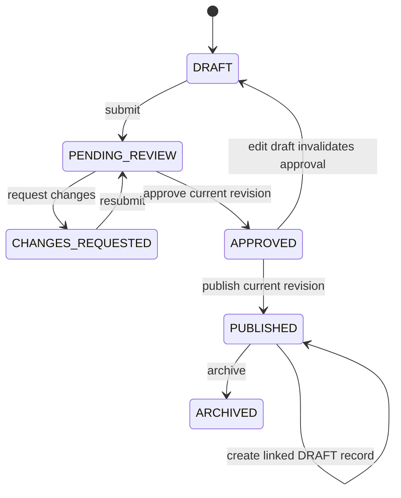
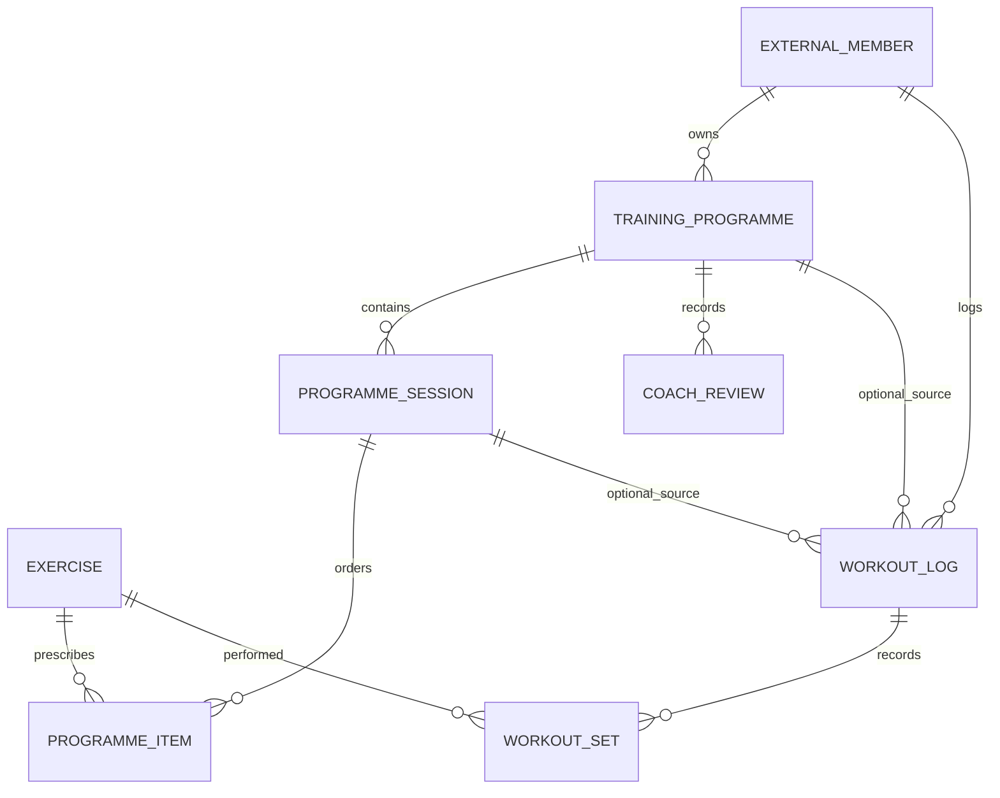

# Smart Gym

Smart Gym is a gym-management platform. This repository currently delivers the
first runnable security vertical slice: Angular sign-in through Keycloak,
an authenticated dashboard, and the Spring Boot membership identity API.

## Development ownership

| Area | Owner |
| --- | --- |
| M1 membership-service | Nour |
| M2 courses-service | Yacine |
| M3 training-service | Pending confirmation: Moez or Mehdi |
| M4 nutrition-service | Pending confirmation: the remaining member |
| M5 Keycloak and shared infrastructure | Shared team responsibility |

These are project ownership assignments, not application roles. Application
roles are `ADMIN`, `COACH`, and `MEMBER`; users may have overlapping roles.
The seeded gym accounts below are development identities and are not mapped
to any developer.

## Development-only URLs and startup

The local HTTP configuration is for development only:

| Component | URL |
| --- | --- |
| Angular/Nginx | `http://localhost:8088` |
| Keycloak | `http://localhost:8080` |
| Realm | `smart-gym` |
| Business API | `http://localhost:8088/api/...` (proxied by Nginx) |

The Spring API and its PostgreSQL database are also exposed on host ports
`8081` and `5433` for local development and provisioning. Browser API calls
should use the Nginx `/api/...` URLs.

1. Copy `.env.example` to `.env` and set unique local-only passwords and a
   provisioning key. Do not use these development secrets outside your local
   machine.
2. Start the core platform:

   ```powershell
   docker compose up --build -d
   ```

3. Wait for Keycloak and the API to become healthy, then provision the four
   development accounts and their business profiles:

   ```powershell
   $env:KEYCLOAK_ADMIN_USERNAME = "admin"
   $env:KEYCLOAK_ADMIN_PASSWORD = "<the KEYCLOAK_ADMIN_PASSWORD from .env>"
   $env:DEV_ADMIN_PASSWORD = "<choose a local-only password>"
   $env:DEV_COACH_PASSWORD = "<choose a local-only password>"
   $env:DEV_MEMBER_A_PASSWORD = "<choose a local-only password>"
   $env:DEV_MEMBER_B_PASSWORD = "<choose a local-only password>"
   .\scripts\provision-dev.ps1
   ```

   Account usernames are `gym-admin`, `gym-coach`, `member-a`, and
   `member-b`. The script creates or updates these Keycloak users, applies
   their application roles, and idempotently provisions their business
   profiles and coach assignments through the Keycloak Admin API and
   development provisioning endpoint. It prints the usernames, never their
   passwords. Passwords are supplied only through environment variables and
   are not stored in source control. The Keycloak administrator account is
   infrastructure-only; it is not an application administrator.
4. Open `http://localhost:8088` and select **Sign in**.

Keycloak credential validation and invalid-credential messages stay on the
Keycloak-hosted login page. The realm uses a small Smart Gym CSS theme. SMTP
is not configured; password-recovery email is intentionally disabled and is
not operational.

The Compose stack routes `/api/membership`, `/api/courses`, and
`/api/nutrition` to the membership API. `/api/training` is routed to the
separate training-service and retains its prefix.

The Keycloak client allowlist contains only the Angular root and the exact
SPA routes (`/dashboard`, `/membership`, `/courses`, `/training`,
`/training/programmes`, `/training/workouts`, `/nutrition`, `/forbidden`,
`/not-found`) plus `/silent-check-sso.html`; the post-logout
redirect is exactly `http://localhost:8088/`, and the allowed web origin is
exactly `http://localhost:8088`.
For an already-imported local realm, update the
`smart-gym-frontend` redirect URI list in Keycloak Admin Console because
Keycloak does not overwrite an existing realm on import.

## Authentication and authorization

- The SPA uses the maintained official `keycloak-js` adapter with
  Authorization Code Flow, PKCE S256, in-memory adapter tokens, and
  a silent SSO-check iframe and initialization before route guards run. The public client has no secret,
  implicit flow and password grant are disabled, and only exact SPA redirect,
  logout, and web-origin URLs are configured.
- Angular attaches access tokens only to same-origin `/api/membership`,
  `/api/courses`, `/api/training`, and `/api/nutrition` requests. A failed
  refresh clears the local token once and returns the user to the public page;
  the SPA does not start a login/refresh redirect loop. `401` ends the local
  session, while `403` opens the forbidden page.
- Spring validates the JWT signature using the Docker-internal Keycloak JWKS
  URL and independently validates the browser-visible issuer
  `http://localhost:8080/realms/smart-gym` and the required
  `smart-gym-api` audience. Networking does not disable issuer or audience
  validation.
- `GET /api/membership/me` derives its subject, display name, and application
  roles from the validated JWT and returns only matching member/employee
  profile IDs plus onboarding status. Missing profiles do not create
  employees or confer roles.
- `GET /api/membership/members/{memberProfileId}/private` enforces access on
  the server: members can read only their own record, coaches only assigned
  members, and admins may read any member record. Hiding a link in Angular is
  not used as authorization. Other module API prefixes also require their
  application roles.
- The development-only profile provisioning endpoint is absent unless the
  Spring `dev` profile is enabled and additionally requires the
  `PROVISIONING_TOKEN`. Do not enable that profile or expose that endpoint in
  production.

For production, terminate HTTPS at a trusted reverse proxy, configure the
public HTTPS Keycloak issuer and exact HTTPS redirect/logout/web-origin
allowlists, configure SMTP before enabling recovery, use managed secrets,
remove development ports and provisioning, and configure the internal JWKS
URL to reach the Keycloak deployment while preserving exact issuer and
audience validation. Never use the development HTTP Compose setup in
production.

## Routes and module ownership

The SPA includes `/` (public landing), `/dashboard`, `/membership` (M1),
`/courses` (M2), `/training` (M3), `/training/programmes`,
`/training/workouts`, `/nutrition` (M4), `/forbidden`, and `/not-found`.
Refreshes are handled by the Nginx SPA fallback. The dashboard
shows the backend identity/profile response, role-aware module navigation,
an account/session section, and logout. Route permissions are checked again
on the backend for API requests.

The demonstrated navigation policy is: `ADMIN` sees all four module areas
and an operations action; `COACH` sees membership, courses, training, and an
assigned-member action; `MEMBER` sees their membership, courses, training,
and nutrition areas. Coaches can list only their server-assigned members.
Members can read only their own private record; admins can read any member
record. These roles can overlap.

## Login acceptance status

The automated API tests cover identity/profile responses, missing/malformed
token `401`, module/admin/coach role checks, onboarding without profile
creation, and member/coach/admin private-record access checks. A Docker
Compose smoke run and browser login/logout smoke test were performed with
development-only accounts.

- [x] Compose starts the core platform.
- [x] Angular loads in a browser.
- [x] Sign in opens the Smart Gym Keycloak realm login page.
- [x] Valid credentials return to Angular; invalid credentials show Keycloak
      feedback.
- [x] Dashboard shows the authenticated user and the backend `/me` response.
- [x] Angular calls `GET /api/membership/me` with an access token.
- [x] Role-aware navigation and direct protected-route authentication work.
- [x] Reloading a protected Angular URL works.
- [x] Missing/invalid token returns backend `401`; insufficient permissions
      return `403`.
- [x] Member A cannot access Member B's private record (automated API test).
- [ ] Expired sessions recover without a redirect loop (not explicitly
      simulated in the browser).
- [x] Logout ends the Keycloak application session and returns to `/`.
- [x] Protected content cannot be accessed after logout.

The business CRUD features for M1-M4, SMTP password recovery, production
HTTPS, and a full browser simulation of token expiry have not been
implemented or tested in the authentication delivery.

## Module 3 — training-service (Phases 2–4)

M3 is a separate Spring Boot 3.4.5 / Java 21 service using the existing
`smart-gym` issuer, `smart-gym-api` audience, and Keycloak realm-role mapping.
It owns a separate `training_db`; Hibernate uses schema validation and Flyway
owns DDL. The service does not connect to M1's database.

- `GET /api/training/exercises`: paginated active catalogue; supports `name`,
  `muscleGroup`, `difficulty`, and `equipmentCategory` filters. Page size is
  limited to 50.
- `GET /api/training/exercises/{id}`: retrieve a catalogue item, including an
  archived item for historical reference.
- `POST /api/training/exercises`, `PATCH /api/training/exercises/{id}`, and
  `POST /api/training/exercises/{id}/archive`: coach/admin-only management.
  Updates accept a `version`; a stale version returns HTTP 409.
- Exercise endpoints return DTOs. Invalid JSON/enums/fields return HTTP 400;
  unauthenticated and insufficient-role requests return HTTP 401 and 403.
- Exercise catalogue enum values are `CHEST`, `BACK`, `SHOULDERS`, `BICEPS`,
  `TRICEPS`, `CORE`, `QUADRICEPS`, `HAMSTRINGS`, `GLUTES`, `CALVES`,
  `FULL_BODY`, `OTHER`; difficulties are `BEGINNER`, `INTERMEDIATE`,
  `ADVANCED`; equipment categories are `BODYWEIGHT`, `DUMBBELL`, `BARBELL`,
  `KETTLEBELL`, `CABLE`, `MACHINE`, `RESISTANCE_BAND`, `OTHER`.
- `POST /api/training/programmes`, `GET /api/training/programmes[/{id}]`,
  and `PATCH /api/training/programmes/{id}` provide coach-authored drafts
  with ordered sessions and typed exercise prescriptions. A prescription
  must specify either repetitions or seconds, not both. `PATCH` replaces the
  draft details/sessions and requires the current `version`.
- Sessions and items also have programme-scoped create, update, delete, and
  order endpoints under `/api/training/programmes/{id}/sessions`. Each
  mutation requires the current programme version (in the request body for
  create/update/order, or the `version` query parameter for delete); use the
  returned version on the next write. Ordering requests must include every
  existing scoped ID exactly once. Nested mutations preserve unaffected
  session/item identifiers.
- `POST /api/training/programmes/{id}/submit`, `/reviews`, `/publish`,
  `/archive`, and `/revisions` implement the review/publish workflow.
  Publishing requires approval of the current revision. Published content
  is immutable; `/revisions` creates a linked draft and leaves its source
  published. Review history remains attached to the original programme.
- Members can list/read their own published programmes only. Coaches can
  manage and review programmes only for currently assigned members. An
  `ADMIN` role alone does not grant access to private programmes or logs.
- `POST /api/training/workout-logs`, `GET /api/training/workout-logs[/{id}]`,
  `PATCH`, and `DELETE` support member-owned logging and coach reads for
  assigned members. Programme/session IDs are checked against the member's
  published programme and selected session. Members can record multiple sets
  from a published session or create standalone workouts, then edit or delete
  their own logs.
- `GET /api/training/me/progress` and coach-only
  `GET /api/training/members/{memberId}/progress` return completed workout
  counts by ISO week, repetition totals, maximum explicitly recorded load,
  and loaded repetition volume (`load_kg × repetitions`). Timed sets and sets
  without a recorded load contribute no load or volume; no bodyweight is
  inferred.
- Stale catalogue, programme, and workout writes return HTTP 409 using
  optimistic locking/version checks. `/api/training/openapi` and
  `/api/training/swagger-ui` expose the API specification/docs; business
  operations still require a bearer token.
- Validation failures return HTTP 400 Problem Details; missing/invalid JWTs
  return HTTP 401; role/resource denials return HTTP 403; missing resources
  return HTTP 404; unavailable M1 identity/assignment checks return HTTP 503.
  Exercise and workout-history lists use zero-based `page` and bounded `size`.

Example draft request (UUIDs are illustrative; response includes `id`,
`version`, `revision: 1`, `status: "DRAFT"`, ordered sessions/items, and an
empty review history):

```json
{
  "memberId": "c6b12091-c34d-4d09-8e99-944b0f5cb8d0",
  "title": "Strength basics",
  "goal": "Build general strength",
  "experienceLevel": "BEGINNER",
  "durationWeeks": 4,
  "version": null,
  "sessions": [{
    "title": "Workout A",
    "notes": null,
    "items": [{
      "exerciseId": "10000000-0000-4000-8000-000000000002",
      "sets": 3,
      "repetitions": 8,
      "durationSeconds": null,
      "restSeconds": 60,
      "suggestedLoadKg": null,
      "notes": null
    }]
  }]
}
```

Example nested programme mutations (use the latest response `version` and the
session/item IDs returned by the service):

```json
{
  "version": 1,
  "session": {
    "title": "Workout B",
    "notes": null,
    "items": [{
      "exerciseId": "10000000-0000-4000-8000-000000000002",
      "sets": 3,
      "repetitions": 10,
      "durationSeconds": null,
      "restSeconds": 60,
      "suggestedLoadKg": null,
      "notes": null
    }]
  }
}
```

Send that body to `POST /api/training/programmes/{id}/sessions`; use
`PUT /api/training/programmes/{id}/sessions/order` with
`{"version":2,"orderedIds":["<session-id-1>","<session-id-2>"]}` to reorder.
Item mutations use the same versioned pattern under
`/sessions/{sessionId}/items`.

Example standalone workout request (member identity is resolved from M1;
clients must not send `memberId`):

```json
{
  "programmeId": null,
  "programmeSessionId": null,
  "performedAt": "2026-10-22T10:00:00Z",
  "notes": "Good session",
  "sets": [{
    "exerciseId": "10000000-0000-4000-8000-000000000002",
    "repetitions": 10,
    "durationSeconds": null,
    "loadKg": 12.5,
    "notes": null
  }]
}
```

Private-record permission summary:

| Operation | MEMBER | COACH | ADMIN only |
| --- | --- | --- | --- |
| Read active exercise catalogue | Own role | Own role | Own role |
| Manage exercise catalogue | No | Yes | Yes |
| Create/edit/review/publish programme | No | Assigned members only | No |
| Read programme | Own published only | Assigned members | No |
| Create/edit/delete workout log | Own member profile | No | No |
| Read workout log/progress | Own member profile | Assigned members | No |

### M1 identity and assignment integration

The existing M1 API provides the profile/assignment contract:
`GET /api/membership/me` maps the validated subject to its business profile;
`GET /api/membership/coach/assigned-members` returns that coach's current
assigned profile IDs. Training-service calls these M1 endpoints using the
incoming user's bearer token, so M1 continues to enforce identity and
assignment against its own database. Member IDs supplied in a programme
request are accepted only after the M1 assignment list confirms them. No
M1 tables are queried or changed, and no tokens are sent through messaging.

The dedicated `training_db` is provisioned by the idempotent
`training-db-init` Compose job using `TRAINING_DB_USER` /
`TRAINING_DB_PASSWORD`; the runtime service does not use M1's database
credentials. Compose defaults these to `training_service` /
`training-local-change-me` for development, so older `.env` files continue
to work. Override both values in `.env` for a local custom setup; never use
the development default in production. Flyway owns schema creation and
Hibernate uses `validate`.
On an existing Compose stack, the init job provisions the separate database
without deleting or recreating the existing PostgreSQL volume.

Start/rebuild the service with the normal command after setting the two
training database values in `.env`:

```powershell
docker compose --env-file .env up --build -d training-service frontend
```

Run the service tests and frontend production build:

```powershell
mvn -f training-service\pom.xml test
npm.cmd --prefix frontend run build
```

Verified on 2026-10-25: the training-service suite passed all 20 tests, the
M1 backend suite passed all 8 tests, the Angular production build passed, and
the current Compose configuration validates. The training-service Docker
image built and was previously started healthy with demo records. Live JWT
signature/issuer/audience checks and browser M3 acceptance remain unverified.

The complete training demo seed is repeatable and development-only. Rebuild
the API first so the development provisioning endpoint returns profile
identifiers via its existing provisioning contract, then run:

```powershell
docker compose up --build -d api training-service frontend
.\scripts\seed-training-demo.ps1
```

It uses Keycloak's admin API to find the existing dev accounts, sends their
profile/assignment setup through M1's protected development provisioning
endpoint, then seeds only `training_db`. It does not reset user passwords or
read/write M1's database. Re-running is safe and refreshes the deterministic
sample catalogue/programmes/logs.

The sample coach can inspect a published plan, a plan pending review, and a
draft for Member A, plus Member B's published starter plan. Sign in as
`gym-coach` to review/publish drafts; `member-a` and `member-b` can view their
own published plans. Member A has three sample logs across different dates,
with both explicit load/repetition and timed/bodyweight sets for progress
screens. Exercises include squat, push-up, dumbbell row, and timed plank.

After seeding, open `http://localhost:8088/training` and refresh if the SPA
was already open. As `gym-coach`, open **Programmes** to see draft, pending
review, and published states; submit the draft, approve the pending revision,
and publish it to exercise those transitions. As `member-a`, open **Programmes**
to see only the published plan and use **Log this session**; **Workout history**
also lets you inspect sample logs and progress or add/edit/delete standalone
and programme-session logs. As `member-b`, verify that only Member B's own
published plan is visible. The exercise catalogue supports coach/admin create,
edit, search/filter, and archive.

The asynchronous AI-generation and generated-image features are not
implemented, so no seeded records pretend to demonstrate them.

The programme screen supports multi-session, multi-item drafts with explicit
ordering, typed repetition/time prescriptions, and review/publication actions.
Members can log a completed published programme session, enter multiple
actual sets, edit/delete logs, and view weekly activity and per-exercise
maximum recorded loads.

### M3 workflow and delivery limits

Programme lifecycle:



Coach review/publication is server-enforced. New revisions are separate
linked draft records, so changing a draft cannot mutate the published source.

Training database relationships (membership IDs are external UUID references
and deliberately have no cross-database foreign keys):



RabbitMQ and Ollama are not present in the core Compose stack, and there are
no existing RabbitMQ message conventions to reuse. A minimum private
development runtime is provided in `docker-compose.messaging.yml`; M5 must
approve/own it before shared use. Start the infrastructure overlay after
setting its development credentials:

```powershell
docker compose --env-file .env -f docker-compose.yml -f docker-compose.messaging.yml up -d rabbitmq ollama
```

It exposes no host ports, persists its data, and does not download an Ollama
model. Configure/pull a chosen local model manually only after the AI adapter
is implemented. Consequently,
the asynchronous AI job/outbox/inbox workflow, real Ollama adapter, prompt
templates/validation/retries, and optional image generation are not
implemented or represented as complete. Before Phase 5, M5 must approve a
single RabbitMQ deployment, durable exchanges/queues, publisher-confirm and
dead-letter conventions, and worker storage ownership. Ollama should remain
opt-in with a pinned model configured explicitly; normal startup must not pull
a model. The optional illustration feature, sample AI jobs, and generated-
media storage are also unfinished.

Not delivered in this checkpoint: AI generation (Phase 5), illustrations
(Phase 6), and comprehensive production integration/browser tests and
diagrams beyond the programme state machine (Phase 7). The development seed
uses the shared M1 provisioning contract to resolve profile IDs and does not
access or modify M1's database.
